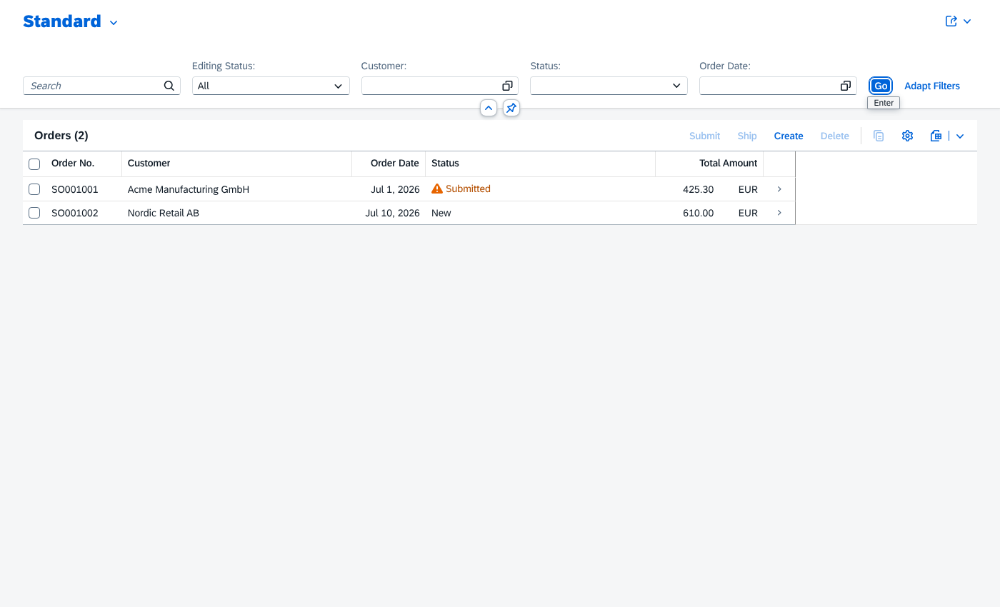
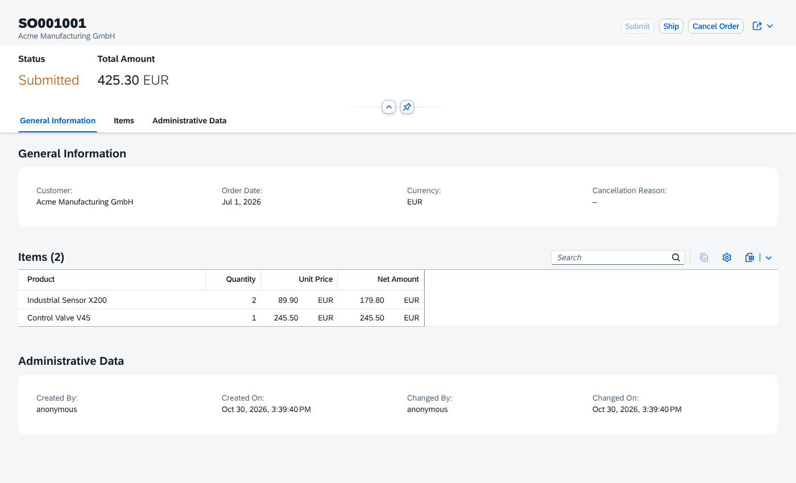
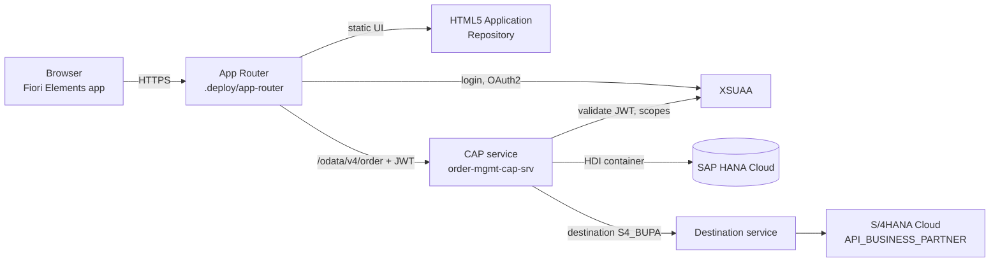

# Order Management on SAP BTP (CAP · Fiori Elements · XSUAA · HANA Cloud)

[](https://github.com/YurySemakov28/order-mgmt-cap/actions/workflows/ci.yml)

A small but complete **SAP Cloud Application Programming Model (CAP, Node.js)** application,
built as a portfolio project by an S/4HANA ABAP / RAP developer to show the same
patterns on **SAP BTP, Cloud Foundry**: draft-enabled Fiori Elements UI, business
actions with status-dependent availability, role-based authorization with XSUAA,
HANA Cloud persistence, and an integration with **S/4HANA (API_BUSINESS_PARTNER)
through the BTP Destination service**.

| | |
|---|---|
|  |  |

## What it demonstrates

| Area | Implementation |
|---|---|
| Domain model (CDS) | `Customers`, `Products`, `Orders` → composition `OrderItems`, code list `OrderStatus` with criticality, `@sap/cds-common-content` for countries/currencies |
| OData V4 + Fiori draft | Lean draft: create/edit order with items, live total recalculation in the draft, validation on save |
| Business logic | Price taken from product, stock check, order numbers `SO000001`, bound actions `submit` / `ship` / `cancel(reason)` with atomic stock reservation |
| Feature control | Actions enabled per status (`@Core.OperationAvailable`), edit/delete only for `NEW` orders (UI annotation **and** server check) |
| Authorization | `@requires` / `@restrict` → roles `OrderViewer`, `OrderManager` → XSUAA scopes, role templates, role collections (`xs-security.json`, `mta.yaml`) |
| Remote service | `API_BUSINESS_PARTNER` (S/4HANA Cloud OData V2): mocked locally, called via Destination `S4_BUPA` in production; customers are validated against S/4 (exists, not blocked) |
| BTP deployment | MTA: CAP service, HDI deployer (HANA Cloud), standalone App Router, HTML5 Application Repository, XSUAA, Destination |
| Quality | 19 automated API tests (`node --test` + `@cap-js/cds-test`), ESLint, GitHub Actions (tests + `cds build --production` + `mbt build`) |

## Architecture



Request flow: user → App Router (authenticates with XSUAA, gets JWT) → CAP service
(checks scopes `OrderViewer` / `OrderManager`) → HANA Cloud; for business partner
data the service resolves destination `S4_BUPA` and calls the S/4HANA OData API.
For an on-premise S/4HANA the same destination would use `ProxyType: OnPremise`
via Cloud Connector + Connectivity service — no code change.

## RAP ↔ CAP — how the concepts map

| ABAP RESTful Application Programming (RAP) | This CAP project |
|---|---|
| CDS view entity / projection | `db/schema.cds`, projections in `srv/order-service.cds` |
| Behavior definition: `with draft`, `draft table` | `@odata.draft.enabled` (draft tables generated) |
| Determination `on modify` | `before('NEW'/'PATCH', OrderItems.drafts)` — price, net amount, draft total |
| Validation `on save` | `before('CREATE'/'UPDATE', Orders)` during `draftActivate` |
| Action with `result [1] $self` | `action submit() returns Orders` + `on('submit')` |
| Instance feature control | `@Core.OperationAvailable`, `@UI.UpdateHidden` + server-side check in `before('EDIT')` |
| Early numbering | `orderNo` assigned in `before('CREATE')` |
| DCL / authorization objects | `@restrict` + XSUAA scopes |
| Service binding (OData V4 UI) | OData V4 protocol adapter, `@path: '/odata/v4/order'` |
| Communication arrangement / outbound | `cds.requires.API_BUSINESS_PARTNER` + BTP destination |
| ABAP Unit with `cl_cds_test_environment` | `test/order-service.test.js` with in-memory SQLite |

## Run locally

Requirements: Node.js 22, `npm i -g @sap/cds-dk`.

```bash
npm ci
cds watch
```

Open <http://localhost:4004> → **Fiori preview** or `/orders/webapp/index.html`.

Mocked users (basic auth, development profile only):

| User / password | Role | Can |
|---|---|---|
| `alice` / `alice` | OrderManager | everything |
| `bob` / `bob` | OrderViewer | read only |
| `carol` / `carol` | — | nothing (403) |

The S/4HANA Business Partner API is mocked automatically from
`srv/external/data/*.csv`, e.g. `GET /odata/v4/order/BusinessPartners`.

```bash
npm test       # 19 API tests: auth, draft, activation, actions, S/4 integration
npm run lint
```

## Deploy to SAP BTP (Cloud Foundry)

```bash
mbt build -t ./mta_archives
cf deploy mta_archives/order-mgmt-cap_1.0.0.mtar
```

Step-by-step guide for a BTP trial account (entitlements, HANA Cloud, destination,
role collections, troubleshooting): **[docs/DEPLOY.md](docs/DEPLOY.md)**.

## Project structure

```
app/orders/               Fiori Elements V4 app (manifest, annotations, UI5 build for HTML5 repo)
app/services.cds          UI annotations entry point
db/schema.cds             domain model
db/data/                  seed data (CSV)
srv/order-service.cds     service, roles, actions, remote BP projection
srv/order-service.js      business logic
srv/external/             reduced API_BUSINESS_PARTNER definition + mock data
test/                     API tests
.deploy/app-router/       standalone App Router (xs-app.json)
mta.yaml, xs-security.json  BTP deployment descriptor and XSUAA security model
```

## Design notes / lessons learned

- **Lean draft events.** While the user edits, events arrive on `OrderItems.drafts`
  as `NEW` / `PATCH` (inside the handler `req.event` is `UPDATE`), not `CREATE`.
  On **Save**, CAP runs `CREATE` / `UPDATE` on the active `Orders` with the whole deep
  document — this is the reliable place for final totals and validations
  (an `after('SAVE')` handler does not fire there).
- **`req.error` vs `req.reject` in draft.** A collected `req.error()` during a draft
  PATCH is downgraded to a message and the PATCH still returns 200. Hard checks use
  `req.reject()`; the same checks run again on activation.
- **Concurrency.** Stock is reserved with a single
  `UPDATE Products SET stock = stock - ? WHERE ID = ? AND stock >= ?` — no read-then-write race.
- **Feature control twice.** UI annotations only hide buttons; the server enforces the
  same status rules (`before('EDIT' | 'DELETE')`, action handlers).
- **Standalone vs managed App Router.** This project ships its own App Router, so the
  app uses an absolute service URL `/odata/v4/order/`. For SAP Build Work Zone
  (managed App Router) switch `manifest.json` to the relative `odata/v4/order/`.

## Roadmap

- [ ] SAP Build Work Zone tile (managed App Router) instead of standalone App Router
- [ ] Event on order submit via SAP Event Mesh / CAP messaging
- [ ] SAP Continuous Integration and Delivery pipeline (in addition to GitHub Actions)
- [ ] Companion RAP project in SAP BTP ABAP Environment (same domain, ABAP Cloud)

## License

MIT
